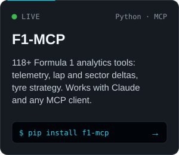
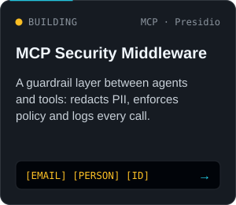
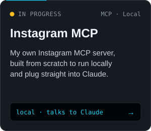
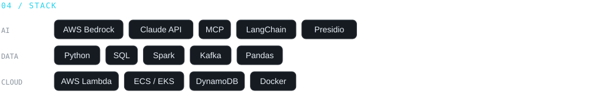
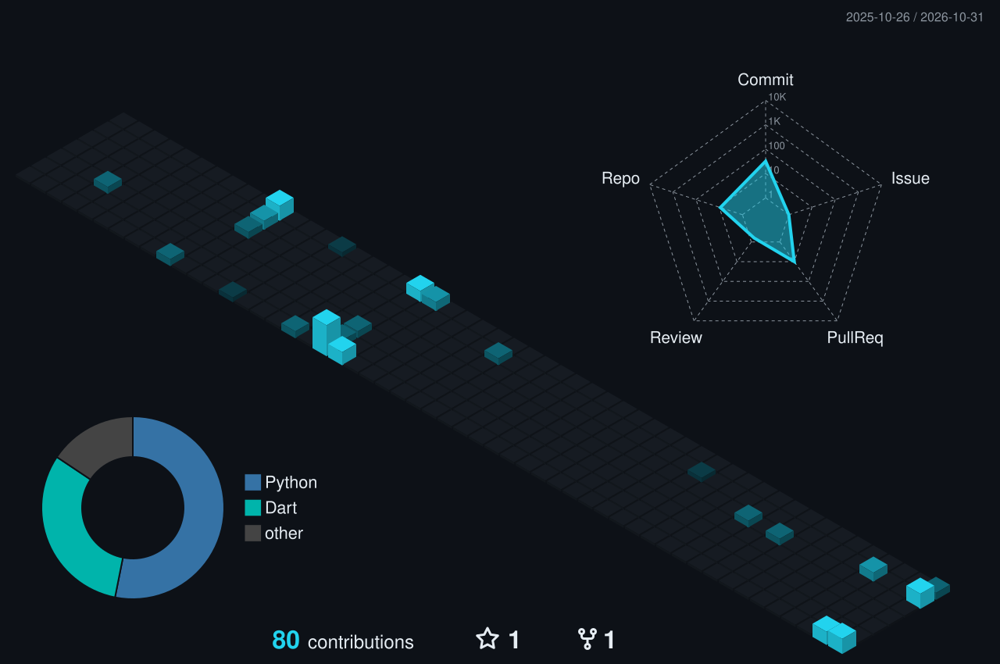

<!--
  Profile README, "Control Room" theme.
  Every image comes in a -dark and a -light version and GitHub picks one to match
  the visitor's theme. To change any wording, edit scripts/build_assets.py and run:
      python3 scripts/build_assets.py
  The 3D skyline at the bottom is rebuilt daily by .github/workflows/profile-3d.yml.
-->

  <picture>
    <source media="(prefers-color-scheme: dark)" srcset="./assets/hero-dark.svg">
    <source media="(prefers-color-scheme: light)" srcset="./assets/hero-light.svg">
    
  </picture>

  <a href="https://www.linkedin.com/in/dhruvkotwani/"><picture><source media="(prefers-color-scheme: dark)" srcset="./assets/btn-linkedin-dark.svg"><source media="(prefers-color-scheme: light)" srcset="./assets/btn-linkedin-light.svg"></picture></a>
  &nbsp;
  <a href="mailto:dhruvkotwani@outlook.com"><picture><source media="(prefers-color-scheme: dark)" srcset="./assets/btn-email-dark.svg"><source media="(prefers-color-scheme: light)" srcset="./assets/btn-email-light.svg"></picture></a>

<picture>
  <source media="(prefers-color-scheme: dark)" srcset="./assets/now-dark.svg">
  <source media="(prefers-color-scheme: light)" srcset="./assets/now-light.svg">
  
</picture>

  

<picture>
  <source media="(prefers-color-scheme: dark)" srcset="./assets/label-builds-dark.svg">
  <source media="(prefers-color-scheme: light)" srcset="./assets/label-builds-light.svg">
  
</picture>

  <a href="https://github.com/Luffy610/f1-mcp"><picture><source media="(prefers-color-scheme: dark)" srcset="./assets/card-f1-mcp-dark.svg"><source media="(prefers-color-scheme: light)" srcset="./assets/card-f1-mcp-light.svg"></picture></a>
  <!-- TODO: point this at the middleware repo once it's public -->
  <a href="https://github.com/Luffy610?tab=repositories"><picture><source media="(prefers-color-scheme: dark)" srcset="./assets/card-mcp-guard-dark.svg"><source media="(prefers-color-scheme: light)" srcset="./assets/card-mcp-guard-light.svg"></picture></a>
  <!-- TODO: point this at the Instagram MCP repo once it's public -->
  <a href="https://github.com/Luffy610?tab=repositories"><picture><source media="(prefers-color-scheme: dark)" srcset="./assets/card-instagram-mcp-dark.svg"><source media="(prefers-color-scheme: light)" srcset="./assets/card-instagram-mcp-light.svg"></picture></a>

 

<picture>
  <source media="(prefers-color-scheme: dark)" srcset="./assets/guardrail-dark.svg">
  <source media="(prefers-color-scheme: light)" srcset="./assets/guardrail-light.svg">
  
</picture>

  

<picture>
  <source media="(prefers-color-scheme: dark)" srcset="./assets/stack-dark.svg">
  <source media="(prefers-color-scheme: light)" srcset="./assets/stack-light.svg">
  
</picture>

  

<picture>
  <source media="(prefers-color-scheme: dark)" srcset="./assets/label-contrib-dark.svg">
  <source media="(prefers-color-scheme: light)" srcset="./assets/label-contrib-light.svg">
  
</picture>

<picture>
  <source media="(prefers-color-scheme: dark)" srcset="./profile-3d-contrib/profile-control-room-dark.svg">
  <source media="(prefers-color-scheme: light)" srcset="./profile-3d-contrib/profile-control-room-light.svg">
  
</picture>

  <b>2nd place</b>, GenAI Barclays Hackathon (Pune regional): <a href="https://github.com/Luffy610/hackathon-nov-2024">Chart Generator</a>, which takes an uploaded dataset, suggests what to analyse with an LLM, then generates and explains the charts
   
  <a href="https://www.credly.com/badges/da053a54-9522-4bd3-aeac-7d888dbe46ca/public_url"><b>AWS Certified Cloud Practitioner</b></a>

Pune, India · powered by chai and terminal logs

